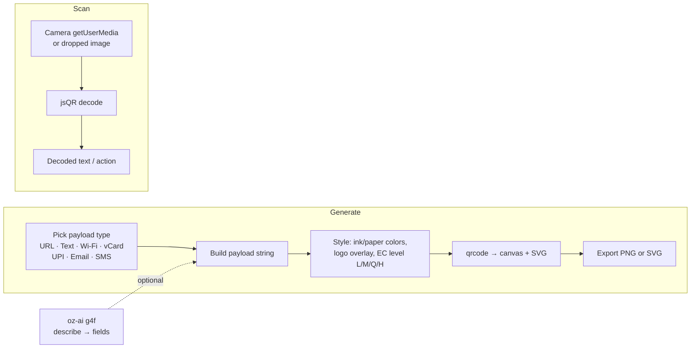

# oriz-qr — QR studio

> Generate and scan QR codes entirely in your browser — links, text, Wi-Fi, vCard, UPI, email and SMS — restyle, add a logo, export PNG/SVG, or decode with your camera.

[](LICENSE)
[](https://github.com/chirag127/oriz-qr/stargazers)
[](https://github.com/chirag127/oriz-qr/commits)
[](https://astro.build)

**Live app:** https://qr.oriz.in · **GHP landing:** https://chirag127.github.io/oriz-qr/ · **Repo:** https://github.com/chirag127/oriz-qr

If this is useful, please ⭐ [star the repo](https://github.com/chirag127/oriz-qr) — it helps others find it.

**100% client-side — no upload, no signup, free.** Every payload is built and every code is decoded on your device; nothing touches a server.

## How it works



## Features

- **7 payload types** — URL, text, Wi-Fi, contact (vCard 3.0), UPI, email, SMS.
- **Restyle** — pick any ink + paper color, add a logo overlay, choose error-correction (L/M/Q/H).
- **Export** — download as PNG (canvas) or crisp SVG (vector).
- **Scan** — live camera decode (`getUserMedia` + `jsQR`) or decode a dropped/picked image.
- **AI describe (optional)** — type "wifi for guests, password hunter2" and it fills the right fields. Uses the shared `@chirag127/oz-ai` g4f client with multi-provider failover; if AI is down the tool still works.
- **PWA-installable**, offline-capable after first load.

## Tech stack

- **Astro 6** (static output) + **React 19** islands
- **Tailwind CSS v4** via `@tailwindcss/vite`
- **qrcode** (generate) + **jsQR** (decode) — dynamically imported only on use, so first paint is instant
- **@vite-pwa/astro** for the installable PWA
- Shared `@chirag127/oz-*` atomic packages: `oz-ai` (keyless g4f client), `oz-file` (file helpers), `oz-tokens-base` (design tokens), `oz-chrome` (oriz.in header/footer shell)
- Deployed on **Cloudflare Pages**; the GHP landing is served from GitHub Pages

## Repo structure

```
oriz-qr/
├── src/
│   ├── components/Studio.tsx   # main React island — generate + scan UI
│   ├── lib/payload.ts          # pure builders for the 7 payload types
│   ├── lib/ai.ts               # optional oz-ai describe → field parser
│   ├── layouts/Base.astro      # page shell (oz-chrome)
│   ├── pages/index.astro       # single-page entry
│   └── styles/theme.css        # --oz-* token overrides
├── astro.config.mjs            # Astro + PWA + sitemap config
├── tests/                      # vitest — payload + AI-parser logic
└── package.json
```

## Quick start

```bash
npm install --legacy-peer-deps
npm run dev        # http://localhost:4321
npm test           # vitest — pure payload + AI-parser logic
npm run build      # static dist/
npm run deploy     # build + wrangler pages deploy
```

## Configuration

No configuration required — the app is fully client-side. The optional AI feature uses the keyless `@chirag127/oz-ai` g4f client (no API key, no env vars).

## Part of the oriz family

oriz-qr is one of ~80 small, single-purpose tools in the [oriz](https://blog.oriz.in) family — each doing one thing well and running **$0 on the Cloudflare free tier**. Start at the hub, [oriz-home](https://oriz.in), or try a sibling like [oriz-md](https://md.oriz.in) (Markdown studio) or [oriz-dev](https://dev.oriz.in) (developer multitool).

## Contributing

Issues and PRs welcome. Keep it client-side and dependency-light; add a vitest case for any new payload/parser logic. Conventional commits are the changelog.

## Status

Stable and live at https://qr.oriz.in.

## License

MIT © Chirag Singhal — chirag@oriz.in
